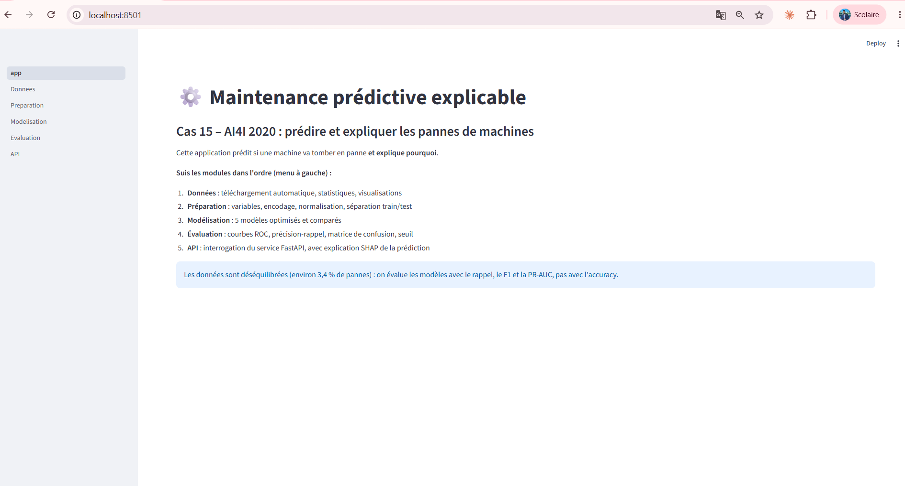
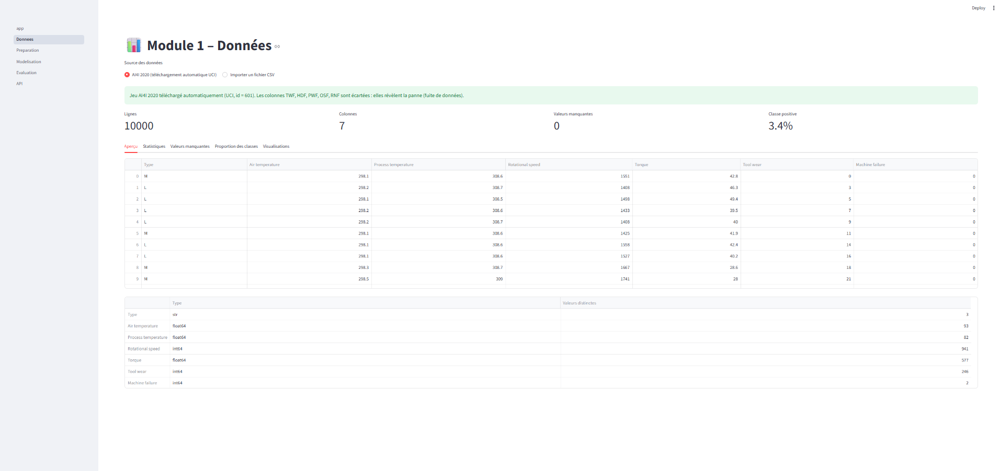
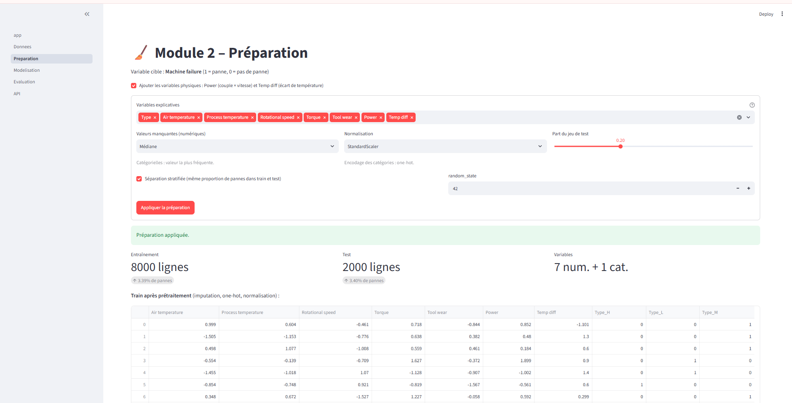
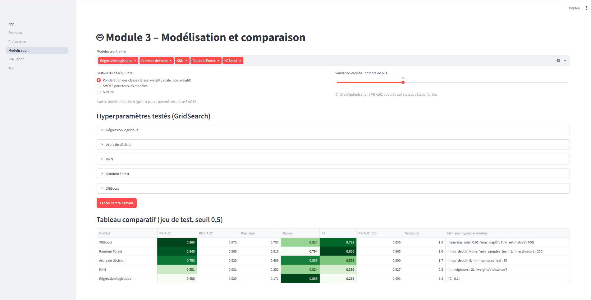
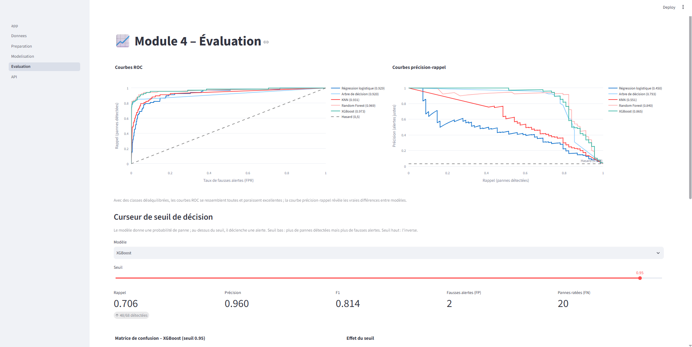
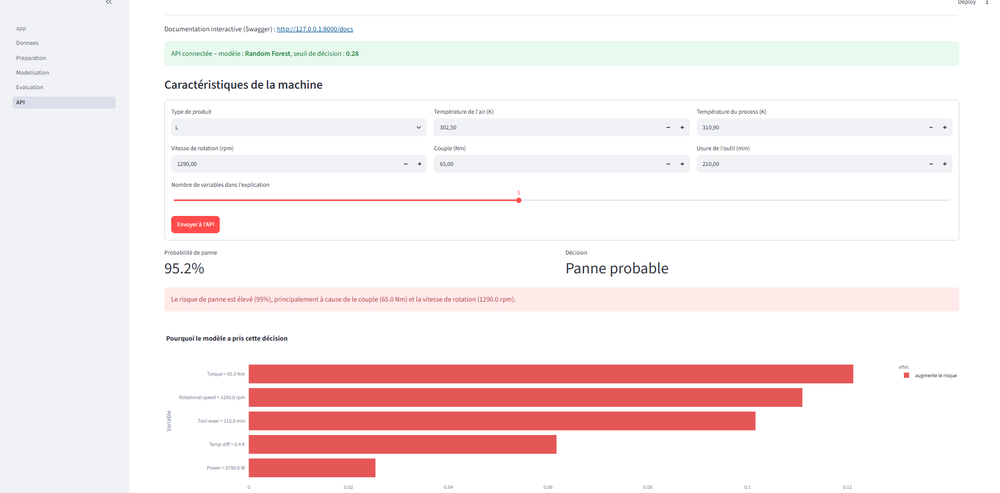
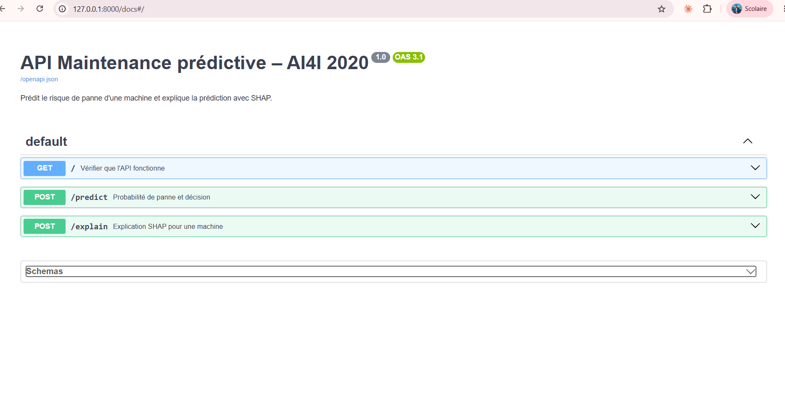

# ⚙️ Maintenance prédictive explicable – AI4I 2020

**Projet Challenge 1 – Application web de classification explicable**
Data Mining · ENSI · 2026-2027 · Enseignante : Rym Besrour

Cas métier n°15 : **prédire les pannes de machines industrielles** et expliquer la décision du modèle.

## 🔗 Liens
- Application web : *(lien à ajouter après le déploiement)*
- Documentation de l'API : `http://127.0.0.1:8000/docs` (en local)

## 📊 Données
- Jeu **AI4I 2020 Predictive Maintenance** (UCI, id = 601), téléchargé automatiquement avec `ucimlrepo`.
- 10 000 machines, 6 variables : type de produit (L/M/H), température de l'air, température du process,
  vitesse de rotation, couple, usure de l'outil.
- Cible : `Machine failure` (1 = panne). **Classes déséquilibrées : 3,4 % de pannes.**
- Colonnes écartées : TWF, HDF, PWF, OSF, RNF (types de panne, fuite de données), UDI et Product ID (identifiants).
- Variables ajoutées : **Power** (couple × vitesse) et **Temp diff** (écart de température), liées aux
  mécanismes physiques de panne.

## 🧠 Démarche
| Module | Contenu |
|---|---|
| 1. Données | Téléchargement automatique ou import CSV, statistiques, valeurs manquantes, visualisations |
| 2. Préparation | Choix des variables, imputation, one-hot, normalisation, séparation train/test stratifiée |
| 3. Modélisation | Régression logistique, arbre, KNN, Random Forest, XGBoost, GridSearch (critère PR-AUC) |
| 4. Évaluation | ROC, précision-rappel, matrice de confusion, curseur de seuil en direct |
| 6. API | Service FastAPI (prédiction + explication SHAP), appelé par l'application |

**Gestion du déséquilibre :** séparation stratifiée, `class_weight="balanced"` / `scale_pos_weight`,
SMOTE pour KNN, évaluation par rappel, F1 et PR-AUC (et non l'accuracy).

## 🏆 Résultats (jeu de test, 68 pannes sur 2 000 machines)
| Modèle | PR-AUC | ROC-AUC | Pannes détectées (seuil 0,5) | Fausses alertes |
|---|---|---|---|---|
| XGBoost | 0,865 | 0,973 | 56/68 | 18 |
| Random Forest | 0,859 | 0,970 | 48/68 | 3 |
| Arbre de décision | 0,793 | 0,920 | 58/68 | 84 |
| KNN | 0,551 | 0,931 | 56/68 | 166 |
| Régression logistique | 0,450 | 0,929 | 59/68 | 287 |

**Modèle retenu : Random Forest avec un seuil de 0,28** → 56/68 pannes détectées (rappel 0,82)
avec seulement **5 fausses alertes** (précision 0,92).

Le problème est non linéaire (les pannes viennent de combinaisons comme couple élevé + vitesse faible),
ce qui explique l'avance des modèles à base d'arbres sur la régression logistique.

## 🚀 Lancer le projet en local
```bash
python -m venv .venv
.venv\Scripts\activate          # Windows  (Mac/Linux : source .venv/bin/activate)
pip install -r requirements.txt
```
Terminal 1 – l'API :
```bash
uvicorn api:app --reload
```
Terminal 2 – l'application :
```bash
streamlit run app.py
```

## 🔌 API
| Endpoint | Rôle |
|---|---|
| `GET /` | État de l'API, modèle et seuil chargés |
| `POST /predict` | Probabilité de panne et décision |
| `POST /explain` | Contributions SHAP et phrase de synthèse |

Exemple de réponse : *« Le risque de panne est élevé (95 %), principalement à cause du couple (65,0 Nm)
et de la vitesse de rotation (1290,0 rpm). »*

## 📁 Structure
├── app.py # page d’accueil Streamlit
├── pages/ # un fichier par module
├── api.py # API FastAPI
├── model.joblib # modèle Random Forest + seuil
├── Projet_Challenge_1.ipynb
├── requirements.txt
└── captures/
## 📸 Captures d'écran
### Page d'accueil


### Module 1 – Données


### Module 2 – Préparation


### Module 3 – Modélisation


### Module 4 – Évaluation


### Module 6 – API appelée par l'application


### Démo vidéo
[▶️ Voir la démo](captures/demo.mp4)

### Documentation de l'API (Swagger)


## ⚠️ Limites
- Le seuil optimal a été choisi sur le jeu de test : résultats légèrement optimistes.
- AI4I 2020 est un jeu de données synthétique, inspiré de conditions industrielles réelles.
